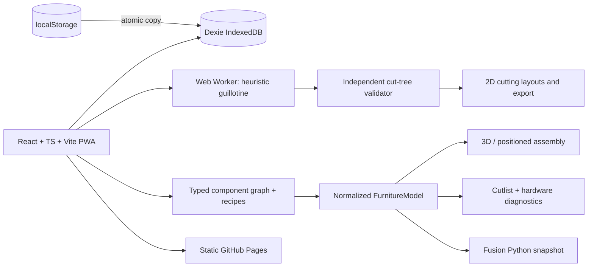

# Architecture overview

**Separation:** Cut-tree placement validation is not equivalent to assembled furniture stability validation. Generic supplier import/export is not a validated per-vendor adapter.
